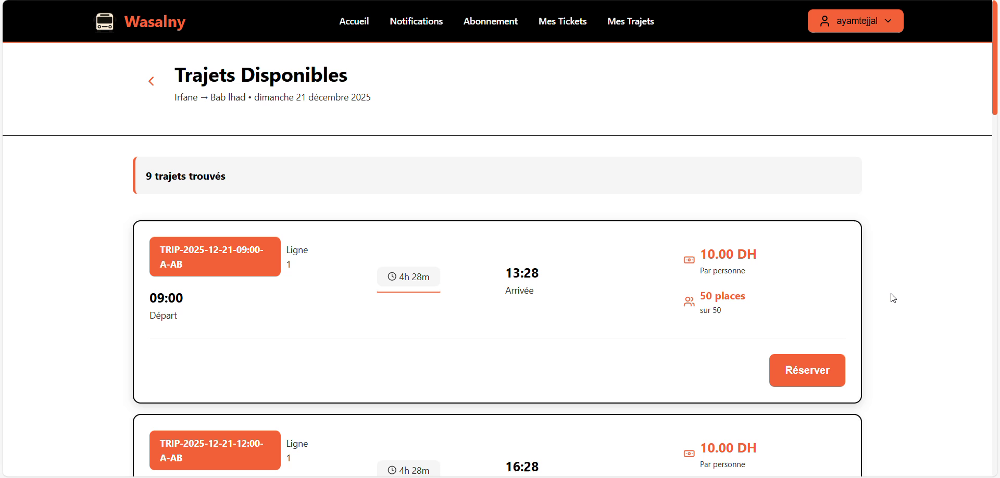
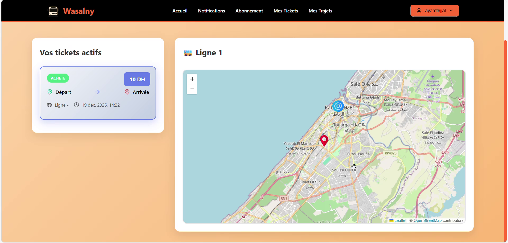
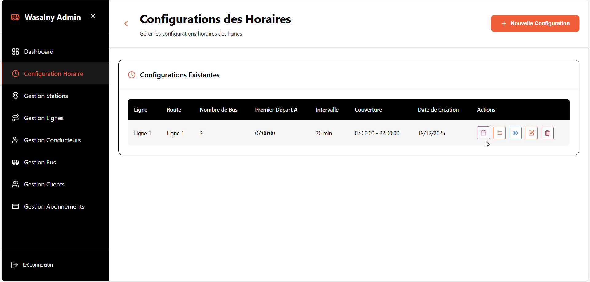
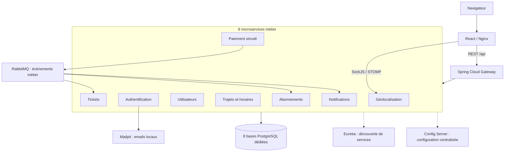

<p align="center">
  
</p>

# Wasalny

Plateforme de gestion du transport urbain organisée en microservices. Wasalny réunit les parcours des passagers, des conducteurs et des administrateurs : trajets et horaires, localisation des bus, tickets et abonnements.

Projet académique réalisé en équipe à l'**ENSIAS** pendant l'année universitaire **2025-2026**. Le dépôt met en pratique la conteneurisation, la découverte de services, la configuration centralisée, les échanges REST et événementiels, ainsi qu'une chaîne d'intégration continue.

## Fonctionnalités présentes dans le code

| Acteur | Interfaces et API présentes |
| --- | --- |
| Passager | Inscription avec vérification d'email, profil, recherche de trajets, horaires, tickets, abonnements et notifications. |
| Conducteur | Consultation des trajets affectés, suivi de localisation et validation des tickets. |
| Administrateur | Gestion des utilisateurs, bus, stations, lignes, horaires et offres d'abonnement. |

Le paiement est une **simulation sans débit réel**. Les parcours métier complets restent à valider ; le périmètre effectivement vérifié est précisé [plus bas](#vérifications-et-ci).

## Aperçu de l'application

Captures issues de la vidéo de démonstration fournie par l'équipe. Elles illustrent la version filmée ; les vérifications de la version actuelle sont détaillées [plus bas](#vérifications-et-ci). Les références sont regroupées dans [l'origine des visuels](docs/visuels-a-fournir.md).

<details open>
<summary>Recherche et résultats de trajets</summary>



</details>

<details>
<summary>Suivi d'un bus sur la carte</summary>



</details>

<details>
<summary>Administration des horaires</summary>



</details>

## Architecture



Chaque service métier dispose de sa propre base PostgreSQL. Les appels synchrones utilisent REST et OpenFeign ; RabbitMQ transporte les événements de paiement, de tickets et d'abonnements. La géolocalisation utilise WebSocket/STOMP avec SockJS. Redis est également fourni dans l'environnement Compose.

Le serveur de configuration lit les fichiers de [`infrastructure/config-server/src/main/resources/config`](infrastructure/config-server/src/main/resources/config). L'environnement local est décrit dans [`docker-compose.yml`](docker-compose.yml).

| Service | Responsabilité principale |
| --- | --- |
| [`auth-service`](backend/auth-service) | Comptes, vérification d'email, connexion et émission des JWT. |
| [`user-service`](backend/user-service) | Profils et opérations d'administration des utilisateurs. |
| [`trajet-service`](backend/trajet-service) | Lignes, stations, bus, horaires et affectations. |
| [`geolocalisation-service`](backend/geolocalisation-service) | Positions des bus et diffusion des mises à jour. |
| [`paiement-service`](backend/paiement-service) | Transactions simulées et publication des résultats de paiement. |
| [`ticket-service`](backend/ticket-service) | Émission et gestion des tickets. |
| [`abonnement-service`](backend/abonnement-service) | Types d'abonnements et souscriptions. |
| [`notification-service`](backend/notification-service) | Historique des notifications liées aux événements métier. |

## Stack technique

| Couche | Technologies |
| --- | --- |
| Backend | Java 17, Spring Boot 3.5, Spring Cloud 2025.0, Spring Security, JPA, OpenFeign. |
| Frontend | React 18, Vite 8, Tailwind CSS, Leaflet. |
| Données et messages | PostgreSQL 15, Redis 7, RabbitMQ, WebSocket/STOMP. |
| Exécution locale | Docker, Docker Compose, Nginx, Mailpit. |
| Vérification | Maven, JUnit, Mockito, GitHub Actions, Gitleaks, Dependabot. |

Le déploiement fourni et vérifié est **local avec Docker Compose**. Kubernetes et le déploiement cloud font partie des pistes d'évolution du projet ; ce dépôt ne contient pas de déploiement validé sur ces plateformes.

## Conteneurisation et automatisation

- **Builds Docker multiétapes** : compilation Java avec Maven, exécution dans une image JRE avec un utilisateur sans privilèges ; build React avec `npm ci`, puis distribution par Nginx.
- **Démarrage coordonné** : contrôles de santé Actuator et dépendances Compose conditionnées à l'état des services.
- **Configuration externalisée** : fichiers par service dans Config Server et secrets locaux générés dans un `.env` exclu de Git.
- **Persistance locale** : volumes dédiés aux bases PostgreSQL, à RabbitMQ et à Redis ; les commandes d'arrêt documentées conservent ces volumes.
- **CI versionnée** : jobs de compilation/tests, build frontend, audit npm, scan de secrets et test de lancement Compose dans [GitHub Actions](.github/workflows/ci.yml).

## Démarrer en local

### Prérequis

- Docker avec le plugin Compose v2, ou Docker Desktop démarré.
- Node.js **22.12 ou supérieur**, pour générer la configuration et lancer le test HTTP.
- Les ports locaux du projet disponibles, notamment `3000`, `8080` et `8025`.

La stack comporte 23 conteneurs, dont onze applications Java et huit PostgreSQL. Prévoir suffisamment de mémoire pour Docker ; le premier build et le démarrage peuvent prendre plusieurs minutes.

Depuis la racine du dépôt :

```sh
node scripts/init-env.mjs
docker compose --project-name wasalny-demo config --quiet
docker compose --project-name wasalny-demo up -d --build --wait --wait-timeout 900
docker compose --project-name wasalny-demo ps
```

Le script génère un `.env` local avec des secrets aléatoires et refuse d'écraser un fichier existant. Les paramètres disponibles figurent dans [`.env.example`](.env.example). Conserver les mêmes valeurs pour redémarrer une installation : changer un mot de passe dans `.env` ne change pas celui d'une base PostgreSQL déjà initialisée.

| Accès local | Adresse |
| --- | --- |
| Application | <http://localhost:3000> |
| Emails de vérification, via Mailpit | <http://localhost:8025> |
| API Gateway | <http://localhost:8080> |
| Registre Eureka | <http://localhost:8761> |
| Console RabbitMQ | <http://localhost:15672> |

Les identifiants RabbitMQ sont les valeurs `RABBITMQ_USER` et `RABBITMQ_PASSWORD` du `.env`. Les ports publiés par Compose sont liés à l'interface locale `127.0.0.1`.

### Essayer le parcours passager

1. Ouvrir l'application et créer un compte client.
2. Récupérer le code de vérification dans Mailpit, puis vérifier le compte.
3. Se connecter et consulter son profil.

Les bases d'une nouvelle installation sont vides : les trajets, bus et offres dépendent des données configurées. Aucun compte administrateur par défaut n'est créé ; son provisionnement initial reste à définir avant une démonstration des écrans d'administration.

Pour consulter les journaux et arrêter cette instance en conservant ses données :

```sh
docker compose --project-name wasalny-demo logs --tail 100 auth-service
docker compose --project-name wasalny-demo down
```

Les volumes sont conservés par `down`. L'option `--volumes` supprime les données persistantes et ne fait pas partie de cette procédure.

## Vérifications et CI

Après le nettoyage, `mvn clean verify` sur les onze modules et le build frontend ont été réexécutés avec succès. Les résultats de lancement Docker ci-dessous proviennent de la passe de lancement précédente.

Les contrôles locaux réalisés couvrent :

- La compilation des onze modules Java et la construction des douze images applicatives.
- **14 tests JUnit** : inscription privilégiée refusée, identité JWT, persistance d'un compte, station dupliquée, contexte Spring et contrôles d'accès aux profils et à l'administration.
- Le build frontend et l'audit npm.
- Le démarrage de 23 conteneurs sains lors de la passe de lancement.
- Un test HTTP d'inscription, vérification d'email, connexion, création/lecture de profil, refus d'accès à un profil tiers et à l'administration, puis acceptation du JWT par le service trajets.

Pour exécuter les tests Java et le build frontend en dehors de Docker, installer Java 17 ou 21 et Maven 3.9, puis :

```sh
mvn -B -ntp verify
npm --prefix frontend ci
npm --prefix frontend run build
npm --prefix frontend audit --audit-level=high
```

Avec la stack locale démarrée et Mailpit disponible :

```sh
node scripts/smoke.mjs
```

Ce test crée un compte de démonstration avec des identifiants aléatoires. Il est prévu pour une instance de développement ou de CI.

Le [workflow CI](.github/workflows/ci.yml) prépare ces contrôles sur les push et pull requests : compilation/tests backend, build et audit frontend, scan de secrets des fichiers actuels, puis lancement Compose et test HTTP. Son exécution sur GitHub reste à vérifier. Dependabot suit les dépendances npm, Maven et GitHub Actions.

### Limites connues

- L'interface de la version corrigée n'a pas été vérifiée directement dans un navigateur. Les captures proviennent de la vidéo de démonstration ; les parcours complets de réservation, paiement, ticket, abonnement, notification et géolocalisation restent à tester.
- Les images Docker et le démarrage Compose complet n'ont pas été relancés après le nettoyage des sources. Les quatorze tests JUnit et le build frontend ont été revérifiés.
- Le changement de mot de passe est actuellement désactivé. La suppression d'un profil ne supprime pas le compte du service d'authentification.
- L'écran de gestion des clients utilise encore des données de démonstration locales ; ses modifications ne sont pas persistées par l'API utilisateurs.
- L'audit npm réalisé ne remplace pas un audit complet des dépendances Java et des images Docker.

Le détail des résultats, des corrections et des précautions concernant les secrets et l'historique figure dans [le compte rendu technique](docs/verification.md).

Les scénarios métier restant à valider sont regroupés dans [les vérifications manuelles](docs/tests-manuels.md). Les tests JUnit et le test HTTP de démarrage sont conservés et exécutés par la CI.

## Conception initiale

Le rapport conceptuel a servi à définir les besoins et les parcours de l'équipe. Le README s'appuie principalement sur les sources, les Dockerfiles, Compose et le workflow CI ; le schéma d'architecture ci-dessus décrit ces composants actuels.

Les diagrammes du parcours passager, de l'achat d'un ticket et du suivi d'un bus sont présentés dans la [documentation de conception](docs/conception.md). Ils restent des modèles initiaux, dont certains détails dépassent l'implémentation actuelle.

## Organisation du dépôt

```text
backend/         8 microservices métier
infrastructure/  API Gateway, Config Server et Eureka
frontend/        Application React et configuration Nginx
scripts/         Configuration locale, diagnostic et test HTTP
.github/         Workflow CI et Dependabot
docs/            Vérifications, conception et ressources visuelles
pom.xml          Agrégateur Maven des 11 modules Java
docker-compose.yml
```

## Équipe

Projet réalisé par **Asma Ait Nasser, Asma H'Mida, Aya Mtejjal et Salma Nadir**, sous l'encadrement du **Pr. Mahmoud Nassar**, pendant l'année universitaire 2025-2026. Les contributions de l'équipe sont conservées dans l'historique Git.
