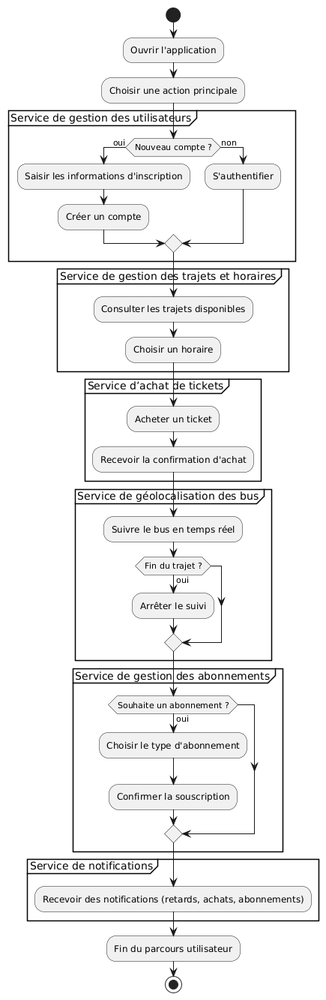
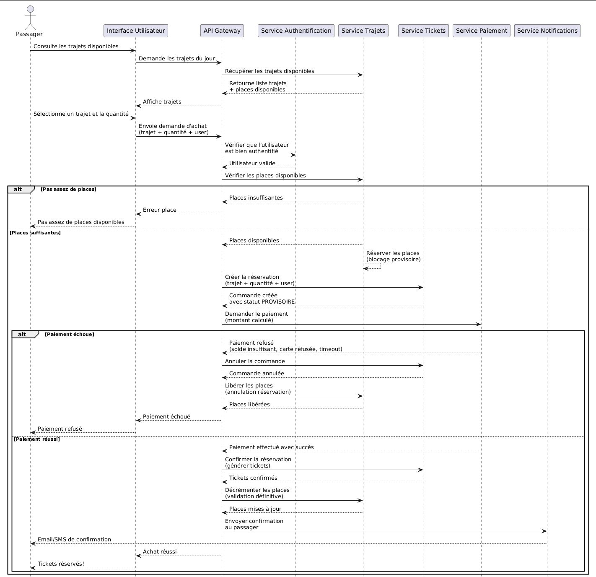
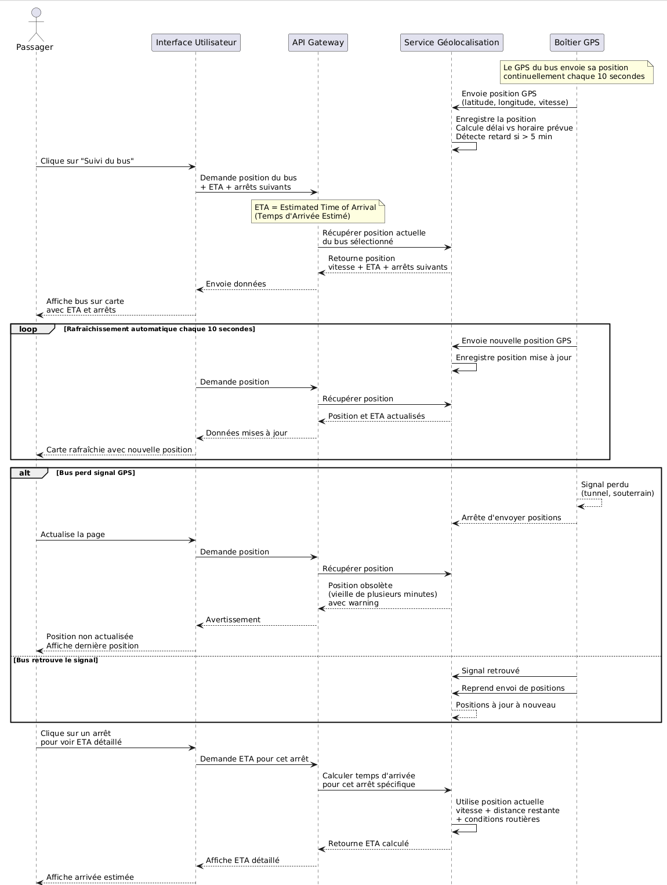

# Conception initiale

Le rapport académique de 2025-2026 décrit les besoins, les acteurs et les modèles UML envisagés par l'équipe. Le [README](../README.md) présente l'architecture et les fonctionnalités présentes dans le code ; cette page conserve les compléments conceptuels.

Les trois figures ci-dessous sont les exports originaux fournis par l'équipe. Leur provenance est précisée dans [la liste des visuels](visuels-a-fournir.md).

## Parcours passager

Figure 1.8 du rapport : « Diagramme d'Activité : Parcours Utilisateur Global ».

Ce modèle décrit l'enchaînement des actions du passager. Les opérations effectivement vérifiées sont détaillées dans le [compte rendu technique](verification.md).

## Achat d'un ticket

Figure 1.12 du rapport : « Diagramme de Séquence : Processus d'Achat de Ticket ».

Le modèle prévoit une réservation provisoire des places, une confirmation et une compensation en cas d'échec. Le code actuel simule le paiement et utilise des événements RabbitMQ ; la coordination complète de ce parcours reste à valider. Ce schéma ne documente donc pas un flux de paiement réel vérifié.

## Suivi d'un bus

Figure 1.15 du rapport : « Diagramme de Séquence : Suivi de Bus en Temps Réel ».

Le modèle initial représente un rafraîchissement périodique et la gestion de pertes de signal GPS. L'implémentation actuelle diffuse les mises à jour par WebSocket/STOMP avec SockJS et propose une carte Leaflet. Le parcours temps réel complet et les scénarios d'incident restent à tester.
